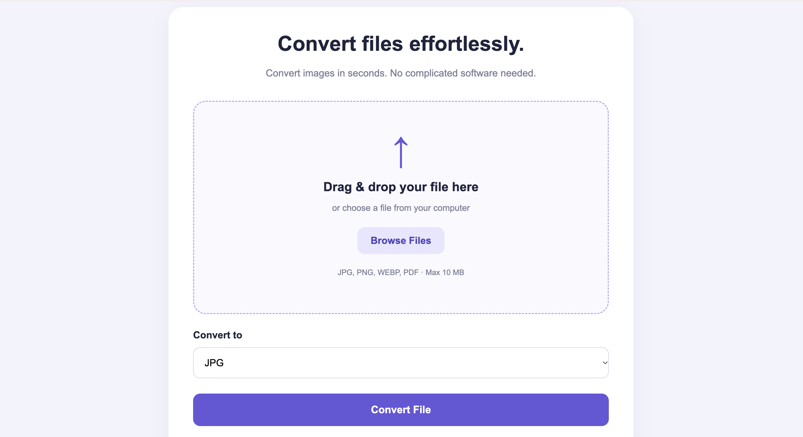
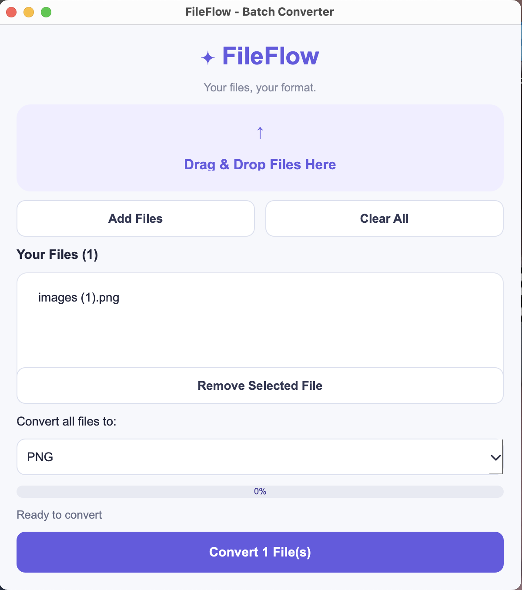

# FileFlow

**A desktop and web-based file converter built with Python, FastAPI, and PySide6.**

Convert images and PDFs through a drag-and-drop interface, with file validation, automated testing, and resource protections.

🌐 **[Try FileFlow Live](https://fileflow-k3e6.onrender.com/web/)**

## Overview

FileFlow is a file conversion application developed to provide a simple, accessible way to convert common image formats and PDF documents.

The project includes two interfaces powered by shared Python conversion logic:

- **Web application:** A responsive HTML, CSS, and JavaScript interface connected to a FastAPI backend.
- **Desktop application:** A PySide6 interface for local conversion on macOS.

FileFlow was developed as an independent software engineering portfolio project, covering application architecture, frontend development, backend APIs, automated testing, error handling, and cloud deployment.

## Features

### File Conversion

- Convert between JPG, PNG, and WEBP.
- Convert images into PDF documents.
- Convert single-page PDFs into JPG or PNG images.
- Convert multi-page PDFs into downloadable ZIP archives containing images.
- Preserve transparent image content with a white background when converting to JPG or PDF.

### Web Application

- Drag-and-drop file uploads.
- Browse and select files.
- Remove or replace selected files.
- Choose output format.
- Preview converted images directly in the browser.
- Download converted files.
- Display conversion errors and upload-limit messages.

### Desktop Application

- Native desktop interface built using PySide6.
- Batch file selection and conversion.
- Drag-and-drop support.
- Progress tracking and conversion feedback.
- macOS Finder Quick Action integration.
- Standalone macOS application packaged using PyInstaller.

### Reliability and Resource Protection

- 10 MB upload limit.
- 20-million-pixel image limit.
- PDF page-count and rendering limits.
- Temporary-file cleanup after conversion failures.
- Output filename handling to reduce accidental overwriting.
- 50 MB maximum output download.
- Basic concurrency limiting.
- API rate limiting with HTTP 429 responses.
- Optional subprocess-based conversion timeout with HTTP 504 responses.

These safeguards reduce common risks but do not constitute a complete security guarantee for untrusted uploads.

## Supported Conversions

| Input Format | Output Formats |
|---|---|
| JPG / JPEG | JPG, PNG, WEBP, PDF |
| PNG | JPG, PNG, WEBP, PDF |
| WEBP | JPG, PNG, WEBP, PDF |
| PDF | JPG, PNG |

Multi-page PDF conversions produce a ZIP archive.

## Technology Stack

| Component | Technologies |
|---|---|
| Backend | Python, FastAPI, Uvicorn |
| Image processing | Pillow |
| PDF processing | PyMuPDF |
| Desktop application | PySide6 |
| Frontend | HTML, CSS, JavaScript |
| Testing | pytest, FastAPI TestClient |
| Packaging | PyInstaller |
| Deployment | GitHub, Render |

## Architecture

```text
                FileFlow
                   |
        +----------+----------+
        |                     |
   Web Interface        Desktop Interface
   HTML / CSS / JS          PySide6
        |                     |
   FastAPI Backend            |
        |                     |
        +----------+----------+
                   |
           Conversion Engine
                   |
          +--------+--------+
          |                 |
        Pillow           PyMuPDF
          |                 |
     Image Output      PDF / ZIP Output
```

The web and desktop interfaces share conversion logic to reduce duplication and keep output behavior consistent.

## Getting Started

### Requirements

- Python 3.12
- pip
- Git

### 1. Clone the Repository

```bash
git clone https://github.com/Burcu-weining/FileFlow.git
cd FileFlow
```

### 2. Create a Virtual Environment

```bash
python3 -m venv .venv
source .venv/bin/activate
```

For Windows, use `.venv\Scripts\activate` instead of `source`.

### 3. Install Web Application Dependencies

```bash
python -m pip install -r requirements.txt
```

### 4. Start the Web Application

```bash
python -m uvicorn api.server:app --reload
```

Open:

http://127.0.0.1:8000/web/

API documentation is available at:

http://127.0.0.1:8000/docs

### 5. Run the Desktop Application

Install the desktop GUI dependency:

```bash
python -m pip install PySide6
```

Then start FileFlow:

```bash
python -m app.interface
```

The desktop application is currently developed and tested primarily on macOS.

## Testing

FileFlow includes automated tests covering:

- Image conversion.
- PDF conversion.
- Filename collision handling.
- Unsupported and corrupted files.
- Oversized uploads and images.
- Cleanup after simulated conversion failures.
- Server concurrency and output-size limits.
- API rate limiting.
- Simulated conversion timeouts.

Run the test suite:

```bash
python -m pip install pytest httpx
python -m pytest tests/ -v
```

At the latest local development checkpoint, **17 automated tests passed**, before adding the newer timeout test.

## Deployment

The web application is hosted on Render and connected to the GitHub repository.

- **Live demo:** https://fileflow-k3e6.onrender.com/web/
- **Health endpoint:** https://fileflow-k3e6.onrender.com/health

The free hosting instance may take longer to respond after a period of inactivity.

## Project Structure

```text
FileFlow/
├── api/
│   ├── server.py
│   └── conversion_worker.py
├── app/
│   ├── converter.py
│   ├── pdf_converter.py
│   ├── interface.py
│   └── styles.py
├── web/
│   ├── index.html
│   ├── style.css
│   └── script.js
├── tests/
├── assets/
├── launcher.py
├── requirements.txt
├── start_server.sh
├── Dockerfile
└── README.md
```

## Screenshots

### Web Application



### Desktop Application



## Future Improvements

- Stronger process memory and CPU resource limits.
- More comprehensive integration and security tests.
- Improved responsive interface and user experience.
- Windows desktop packaging.
- Chrome browser extension.
- Additional supported conversion formats.

## Project Status

**Active development — public web demo available.**

FileFlow is a portfolio project and remains under active development. Upload non-sensitive test files only while public-upload safeguards are being improved.